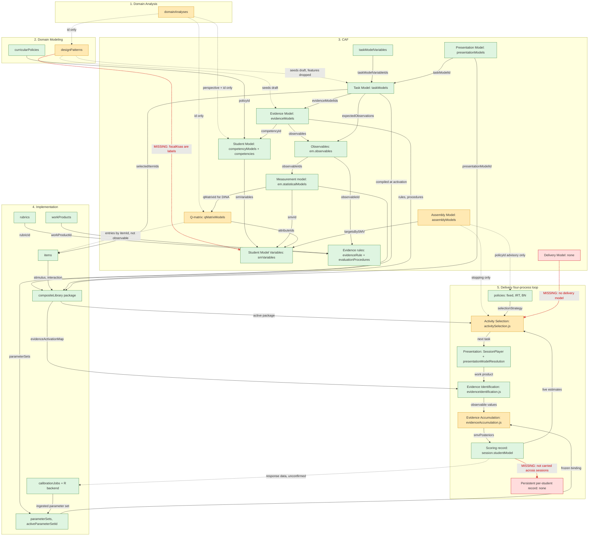

# Off-calendar: textbook ECD gap audit

**Not D146.** Date: 2026-10-27. Not a calendar unit. No product code.

Read of rvkmar/ecd-ai main (`ff2a541`, product tip `f7ec896`) against Mislevy, Steinberg and Almond 2003, Mislevy and Riconscente 2006, and Almond, Steinberg and Mislevy 2002. The chart and table below are that audit. Carried forward in `claude/progress-ledger.md` as G15 to G22. The accumulation row below repeats this audit's wording that `jointPrior` is unused at scoring. That use is already D129 (continuous joint, one correlated partner). `bnPosteriors` stays F24. The ledger cross-references both and does not open a new id. The two High gaps (G15, then G16) are the next off-calendar work, one PR each.

Legend: green means present and linked, amber means partial, red means missing. A solid link is present, a dashed link is partial, and a dashed red link with an x is missing.

## (A) Chart

## (B) Gaps table

| Element | Textbook expectation | App status | Evidence | Suggested fix | Priority |
|---|---|---|---|---|---|
| Delivery Model | Delivery model binds the student, evidence, task, assembly and presentation models into one deliverable assessment (platform, timing, security, accommodations) | Missing. No collection. Session is built ad hoc from taskIds + selectionStrategy; assembly model is found by competency model, not declared | src/utils/schema.js (no deliveryModels; sessions has no assemblyModelId); server/delivery/activitySelection.js resolveAssemblyModelForSession | Add a deliveryModels collection (assemblyModelId, policyId, presentation and admin rules) and make sessions cite it | High |
| Persistent student model | Student model state carried as the student's scoring record across tasks and occasions | Partial. Posteriors live on session.studentModel only; students holds id and name | schema.js students, sessions.studentModel; evidenceAccumulation.js applyPosteriorsToSession | Add a per-student record (studentId, smvId, posterior, sourceSessionIds) updated on finish, and seed new sessions from it | High |
| Design pattern KSAs to student model | Focal KSAs name what the student model measures | Missing link. focalKsas are label-only menus; seeding asks for a competencyId by hand | schema.js DESIGN_PATTERN_LABEL_ONLY_MENUS; server/services/seedFromDesignPattern.js | Let focal KSAs cite a competency or smvId, and check it at seeding | Med |
| Design pattern to task model | Characteristic and variable features, rubrics flow into the task model | Partial. Seeds draft EM and TM (D137), but characteristic features do not reach blueprintConstraints and rubric ids do not become evaluation procedures | server/services/seedFromDesignPattern.js | Carry characteristic features and potentialRubrics into the seeded drafts | Low |
| Domain analysis | Valued knowledge, work and task features feed design patterns and models | Partial. Feeds psychologicalPerspective inheritance, contentStandards and domainAnalysisId pointers; valuedKnowledge and taskFeatures are not referenced by id downstream | schema.js domainAnalyses, competencyModels.domainAnalysisId, qMatrixModels.domainAnalysisId, designPatterns.domainAnalysisId | Let KSAs and features cite domain analysis entries by id | Low |
| Observables | First-class variables linking evidence rules to the measurement model | Present and linked. Embedded in evidenceModels.observables with ids, evidenceRule, evaluationProcedures.observableId, statisticalModels.structureConfig.observableIds (strict check) | schema.js evidenceModels; evidenceIdentification.js | None needed; optional: a standalone observable registry for reuse across EMs | Low |
| Measurement model to SMV | Each statistical model updates declared SMVs | Present and linked via structureConfig.smvId, or the single SMV of that type | server/delivery/evidenceAccumulation.js (smvResolution) | None | Low |
| Q-matrix | Maps observables (or tasks) to attributes (SMVs) | Partial. attributeIds are binary SMVs (validated); entries are by itemId, not observableId, so a multi-observable item cannot be mapped per observable | schema.js qMatrixModels; samples/ecd-sample-complete/qMatrixModels.json | Allow entries keyed by observableId (itemId optional) | Med |
| Assembly Model | Targets, constraints and rules for how many and which tasks | Partial. targetsBySMV and stoppingRules are used; selectionAlgorithm.policyId is only a warning if it disagrees; no content or blueprint constraints; progress not persisted | server/delivery/activitySelection.js evaluateStoppingRules, assemblyProgress.js | Make the AM's policy authoritative via the Delivery Model, add content constraints | Med |
| Activity Selection (adaptive loop) | Uses the assembly model and current student model to choose the next task | Partial. Uses active package + live smvPosteriors (D56) with IRT information and BN information gain, but only within the fixed session.taskIds roster; BN falls back to first unanswered when nothing can be ranked; legacy questions path still present | activitySelection.js (selectIrt, selectBayesianNetwork, candidatesFor) | Draw candidates from the active packages for the AM, not only the roster; remove legacy path | Med |
| Presentation process | Presentation model drives what the student sees | Present. Package stamps presentationModelId; next-task route resolves it live; SessionPlayer applies presentationChrome. How fully layout, conditionalDisplay and accessibility are rendered is unconfirmed | server/delivery/presentationModelResolution.js; server/routes/sessionRoutes.js (resolvePresentationModel); src/components/sessions/SessionPlayer.jsx | Confirm each presentationModels field is honoured in presentationChrome | Low |
| Evidence Identification | Work product to observable values via evidence rules | Present and linked. Uses package evidenceActivationMap; refuses stale or missing package | server/delivery/evidenceIdentification.js | None | Low |
| Evidence Accumulation | Updates the student model from observables via the measurement model | Partial. IRT, Rasch, CTT, DINA, G-DINA run; bnPosteriors is never written (F24); jointPrior is validated but not used at scoring (D129) | evidenceAccumulation.js; schema.js competencyModels.jointPrior | Implement BN accumulation or hide BN; use jointPrior at scoring | Med |
| Composite library | Compiled task + evidence package used at delivery | Present and linked. Built at activation from task model, items, bound EMs, rubrics; parameters not baked (ADR 0003) | server/compositeLibrary/builder.js, activation.js | None | Low |
| Calibration feedback | Calibrated parameters feed scoring | Present. Ingested parameterSets with activeParameterSetId win over pilot for new sessions (D68 freezes per session). Where the job's response data comes from was not checked | server/delivery/parameterSourceResolution.js; server/routes/calibrationJobsRoutes.js | Record the source session ids on each calibration job | Low |
