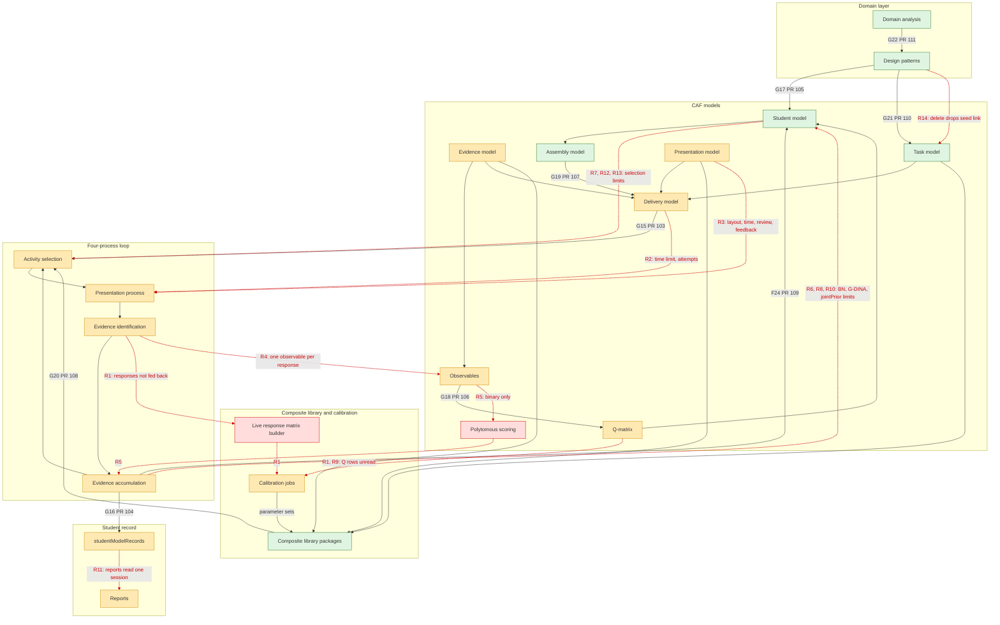
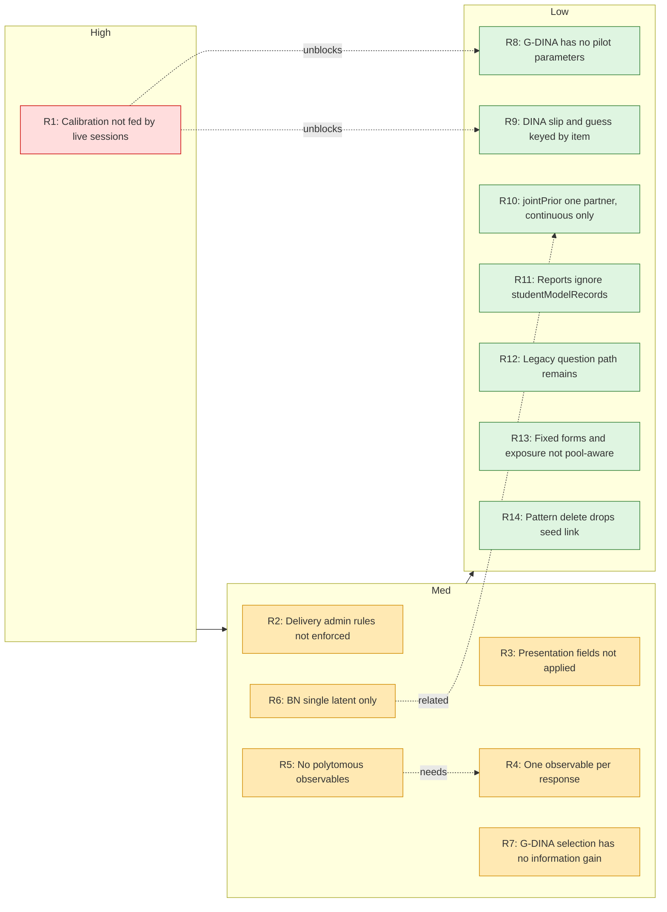

# Off-calendar: textbook ECD gap re-audit

**Not D146.** Date: 2026-10-28. Not a calendar unit. No product code.

Re-read of rvkmar/ecd-ai main at `77fafb9` (after PR #111) against the same textbook layers as `claude/day145r-offcal-ecd-gap-audit.md`. Carried forward in `claude/progress-ledger.md` as R1 to R14. G15 to G22 and F24 stay closed. D129 stays closed and is not reopened.

PRs 103 to 111 closed every structural hole in the first audit. The delivery model, persistent student record, KSA to student model link, observable-level Q-matrix, assembly constraints, package-driven activity selection, Bayesian network accumulation, pattern to task model seeding, and domain analysis ids are in the code. What remains is depth. Fourteen remaining gaps: 1 High, 6 Med, 7 Low. The biggest is the feedback arc: calibration still runs on named fixtures or a hand-supplied matrix, not on live session responses, and it ignores the authored Q-matrix.

## Corrections

- jointPrior is used at scoring for continuous IRT and Rasch with one correlated partner. The first audit's "jointPrior unused" was wrong. The F24 / D129 ledger row already said the bivariate EAP reads it. This re-audit confirms that use. R10 is the remaining scope (one partner, continuous only). D129 is not reopened.
- The G20 note "IRT is still nearest difficulty" is out of date. The item path uses max-fisher. Only the legacy question path uses nearest difficulty (R12). `claude/day145x-offcal-activity-selection.md` still has the old sentence. The ledger row is corrected here.
- Calibration feedback is now Partial. The first audit called it Present and left the response source unchecked. That hole is R1 (High).
- The `claude/day145z-offcal-pattern-task-features.md` claim that Blueprint Constraints stays locked while the parent Evidence Model is draft is not in the code. `canNavigateTaskModelRail` blocks forward jumps while the task model itself is editable, and a non-draft task model is read-only. Parent evidence-model status is not an input (`src/components/taskModels/TaskWizard/taskWizardShellContract.js`).

## After the audit commit

D151 to D153 merged after `77fafb9`. Skimmed `claude/day151-taskspecs-schema.md`, `claude/day152-generate-family.md`, `claude/day153-generation-preview-family.md`, and the diff `77fafb9..0af722a`.

| Unit | Product | What landed | Effect on R1 to R14 |
|---|---|---|---|
| D151 | `d3477b0` | Derived `taskSpecs`. Authored POST refused. Template change marks specs stale. | None |
| D152 | `5d2dde2` | Generate the projected family. Refuse 0 and over 500. 409 if specs exist. | None |
| D153 | `f81bc2b` | Preview shares the generate plan. Replace and retire the family. | None |

Also on main after `77fafb9`, and also not an R-gap change: D133 confirm no longer relays every keystroke through the neighbourhood graph (`9392667`), and live R pipeline tests run when plumber is healthy on `:4000` (`43fb35f`). That flag does not build a session response matrix.

No R row is closed or narrowed by those commits.

## Still present

The first audit's present rows stay present: observables, measurement model to SMV, and the composite library. Evidence identification is still wired, and R4 is the remaining depth (one observable per response). The first audit's "present" calibration row is now Partial (R1).

## (A) Remaining gaps by architecture

## (B) Remaining gaps by severity

## (C) Gaps table

The ledger table is the carried record. Same rows:

| Id | Element | What's missing | Evidence files | Suggested fix | Severity |
|---|---|---|---|---|---|
| R1 | Calibration feedback | Only `source: "sessions"` builds from live data, and only for item analysis. IRT, DINA, G-DINA and CTT jobs use named fixtures or a caller-supplied responseMatrix. The scheduled enqueue skips because "live session-matrix builders are not yet wired". Authored Q-matrix rows are not read, and source session ids are not recorded. | `server/routes/calibrationJobsRoutes.js`, `server/r/scheduledCalibrationEnqueue.js`, `server/r/calibrationFixtures.js` | Add a session response-matrix builder per family that reads Q-matrix entries. Stamp source session ids on the job and the parameter set. | High |
| R2 | Delivery model administration | timeLimitMinutes, attempts, review and feedback mode are stored and validated but nothing enforces them. The auto-finish deadline comes only from session or task endTime. | `server/routes/sessionRoutes.js`, `server/utils/autoFinish.js`, `server/routes/deliveryModelsRoutes.js`, `src/utils/deliveryModelReadiness.js` | Derive the session deadline, attempt cap and review/feedback flags from the cited delivery model at session create, and enforce them in submit, next-task and finish. | Med |
| R3 | Presentation process | presentationChrome computes timeMultiplier, allowReview and showFeedback, but SessionPlayer uses only showProgress, allowSkip and styling. layout is never read. The extra-time accommodation has no effect. | `src/components/sessions/presentationChrome.js`, `src/components/sessions/SessionPlayer.jsx`, `server/delivery/presentationModelResolution.js` | Apply timeMultiplier to the deadline (with R2), gate back-navigation on allowReview, render per-item feedback, and honour layout. | Med |
| R4 | Evidence identification | One package entry per item maps one response to one observationId. A work product cannot yield several observables. | `server/delivery/evidenceIdentification.js` | Let an evaluation procedure emit a list of observables per work product, each keyed to its Q-matrix row. | Med |
| R5 | Observables and measurement model | Every observable is binary (`u = activated ? 1 : 0`). Rubric levels collapse to 0 or 1, human rating accepts only a boolean, and there is no GRM or PCM. | `server/delivery/evidenceAccumulation.js` (lines 492 to 499), `server/routes/sessionRoutes.js` (human-rating) | Add ordinal observable values and a polytomous IRT family, and let human rating post a level. | Med |
| R6 | Evidence accumulation, BN | The network must have exactly one latent node with edges to observables (naive-Bayes star). Multi-SMV networks are refused at save and at scoring. Overlaps closed F24. D129 stays closed. | `server/delivery/bayesianNetwork.js` (lines 162, 385) | Support latent to latent edges with exact inference for small networks, or document the single-latent limit as policy. | Med |
| R7 | Activity selection, G-DINA | resolveDinaParameters returns params only for `dina`, so G-DINA sessions fall back to pool order (D60 P1-5). | `server/delivery/activitySelection.js` | Add expected posterior entropy or KL information for G-DINA. | Med |
| R8 | Evidence accumulation, G-DINA | G-DINA has no pilot parameters and cannot score until a calibrated set exists. | `server/delivery/evidenceAccumulation.js` (lines 960 to 990) | Allow authored pilot parameters, or derive DINA-equivalent starting values. | Low |
| R9 | Q-matrix at scoring | DINA slip and guess are keyed by itemId, so observables on one item share parameters even when cited separately in the Q-matrix. | `server/delivery/activitySelection.js`, `server/delivery/evidenceAccumulation.js` | Key slip and guess by observableId when the cell cites one (pairs with R1 and R4). | Low |
| R10 | jointPrior | Continuous IRT/Rasch update one correlated partner and refuse when an SMV correlates with two or more. BN, DINA and CTT ignore jointPrior. Overlaps closed D129. D129 is not reopened. | `server/delivery/jointContinuousAccumulation.js` (lines 67 to 83), `server/delivery/evidenceAccumulation.js` (about line 1118) | Extend to a full multivariate EAP or quadrature, or record the scope as a design limit. | Low |
| R11 | Student record use | Learner, teacher, class and district reports read one session (irtTheta, bnPosteriors). No report reads studentModelRecords. Carry-forward is off unless the body or delivery model turns it on. | `server/routes/reportsRoutes.js` (lines 171 to 182), `server/routes/sessionRoutes.js` (line 267) | Add a cross-occasion report built from studentModelRecords. Consider default carry-forward on the delivery model. | Low |
| R12 | Activity selection, legacy | The legacy questionId path still ranks by nearest difficulty to studentModel.irtTheta. The item path now uses max Fisher. | `server/delivery/activitySelection.js` (selectLegacyQuestionCandidate, line 954) | Migrate legacy questions to items and remove the path. | Low |
| R13 | Activity selection, forms and exposure | Fixed-order forms do not draw from the assembly package pool. item.exposureControl.usageCount is not a ranking input, so adaptive selection has no exposure control beyond assembly caps. | `server/delivery/activitySelection.js` | Build fixed forms from the pool, and add randomesque or Sympson-Hetter exposure control. | Low |
| R14 | Design pattern provenance | Deleting a design pattern drops seededFrom.designPatternId. From ledger P1 D150, not verified in code. | `ledger.md`, `claude/day150-adversarial-w30.md` | Block deletion when seeded drafts cite the pattern, or keep a tombstone. | Low |

The audit's `ledger.md` is this repo's `claude/progress-ledger.md`. R14 was not re-checked in `server/routes/designPatternsRoutes.js` for this record.

## Closed since the first audit

- G15 Delivery Model, PR 103
- G16 Persistent student model record, PR 104
- G17 Design pattern KSAs to student model, PR 105
- G18 Q-matrix observable cells, PR 106
- G19 Assembly Model constraints, PR 107
- G20 Activity selection from the package pool, PR 108
- F24 Bayesian network accumulation, PR 109
- G21 Design pattern to task model, PR 110
- G22 Domain analysis ids, PR 111

## Verification

No product code. `repoGuards` scans `src/` and `server/`, not `claude/`, so the suite was not re-run. Same choice as the 2026-10-27 audit close.

## Calendar

D146 was not marked. This record has no calendar event. The next unit stays D154. Re-calibrate before D154. Do not start D155 from this record. W29 stays open. W31 stays open (D154 and D155 remain).

## Next

Do not treat this as D146. The next off-calendar substance, if any, is R1 alone. Calendar next stays D154.
